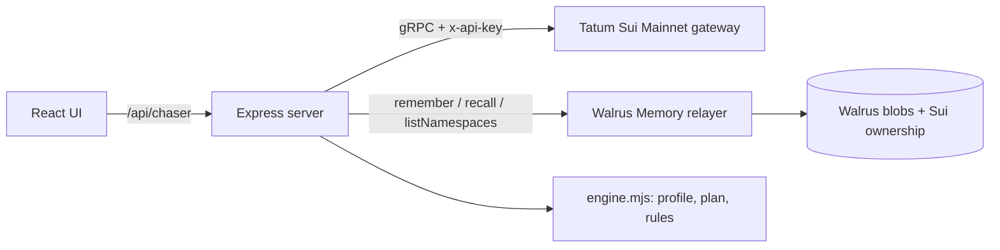

# Invoice Chaser

**An invoice tracker for freelancers paid in USDC on Sui that learns how each client pays, and chases each one differently.**

Built for **Total Recall** (Tatum × Walrus Memory, 20 Oct – 10 Nov 2026) · Track 03 Consumer Finance · started in [Tatum AI Builder](https://ai.tatum.io) (see [`docs/ai-builder/prompts.md`](docs/ai-builder/prompts.md), tag `ai-builder-v0`).

> Acme always pays 5 days late and ignores friendly nudges. Beta pays on the due date. Gamma short-pays by ~10%.
> Every invoicing tool treats them the same. Invoice Chaser remembers, and the reminder plan changes because of it.

## What it does

1. **Issue a USDC invoice** with a *unique payable amount* (e.g. `300.004217`): the micro-decimals identify the invoice on-chain.
2. **Verify payment on Sui Mainnet through Tatum's gRPC gateway**: paste the transaction digest; the server reads `balance_changes` and settles the invoice as paid or partial.
3. **Remember everything in Walrus Memory**: invoices, reminders (with tone), payments (delay, amount), and your own rules ("never chase Acme before the 10th").
4. **Plan the next reminder from memory**: predicted pay date (EWMA of past delays), the tone that actually worked for this client, your hard rules. A **"Why?" panel** lists the memories behind the decision, and an **"Ignore memory"** switch shows what a memory-less tool would do.

## How it learned (same invoice, two plans)

| inv-101 · Acme · due 5 Nov | Ignore memory | With Walrus Memory |
|---|---|---|
| First reminder | 6 Nov, friendly | **9 Nov, formal** |
| Predicted payment | — | **10 Nov** (EWMA of 4 paid invoices: +4, +6, +5, +5 days) |
| Why | default schedule | formal reminders were followed by payment within 3 days 4/4 times; friendly 1/3 |

Prediction error for Acme, invoice by invoice: **4 → 2 → 0 → 0 days** (`computeProfile().history`, covered by tests).

## How it uses Walrus Memory

Walrus Memory is the **system of record**, not a log on the side.

- Every event is one memory: a human sentence plus a machine tag, e.g.
  `Acme Corp paid inv-095 in full (3500.002202 USDC) on 2026-10-20, 5 day(s) after due… \n#ic {"type":"invoice_paid","delay_days":5,"reminders":1,"last_tone":"formal",…}`
- One namespace per client (`ic:main:client:<id>`), so each stays far below the 100-record recall window.
- **On boot the server holds no data.** It lists the `ic:main:*` namespaces, recalls each one and rebuilds clients, invoices and learned profiles from Walrus ([`server/memory.mjs`](server/memory.mjs)). The **Total Recall** button does the same on demand: wipe local state, rebuild from Walrus.
- Writes are queued in the background (a mainnet write takes ~25 s) with retries; the UI shows *writing to Walrus…* until the relayer confirms, then links the blob on Walruscan. Nothing is shown as saved before it is.

## How it uses Tatum

All chain reads go through **Tatum's Sui Mainnet gRPC gateway** (`sui-mainnet-grpc.gateway.tatum.io:443`, `x-api-key`), using `SuiGrpcClient` from `@mysten/sui` over native gRPC ([`server/sui.mjs`](server/sui.mjs)):

| Purpose | Call |
|---|---|
| Verify an invoice payment | `LedgerService.GetTransaction` → `effects.status`, `balance_changes`, `timestamp` |
| Detect incoming USDC | `StateService.GetBalance` (balance watcher, `/api/chaser/cron-check`) |
| Live proof | `LedgerService.GetCheckpoint` (latest) |

Sui JSON-RPC is deprecated, and gRPC has no "transactions by address" query. That is why invoices carry unique amounts and settle by digest. Calls are throttled to stay under the free tier's 3 req/s.

## Architecture



- `server/engine.mjs`: pure logic (state derivation, profile, plan, preference parser). *AI proposes, code decides*: every number is deterministic and tested.
- `server/memory.mjs`: Walrus Memory store, write queue, Total Recall loader.
- `server/sui.mjs`: Tatum gRPC client.
- `server/routes/chaser.mjs`: API.
- `src/App.tsx`: UI (generated by Tatum AI Builder, then wired to the real API).

## What's real and what's seeded

| | |
|---|---|
| Walrus Memory writes/reads | **Real**, Mainnet relayer. |
| Tatum gRPC (checkpoint, balance, tx verification) | **Real**, Sui Mainnet. |
| Client history Aug–Oct 2026 (38 memories) | **Seeded** with [`scripts/seed.mjs`](scripts/seed.mjs) in the app's own format; each carries `"seed": true` and is labelled in the UI. Seeded payments have no digest. |
| New invoices, reminders, rules, payments made in the app | **Real** memories; payments verified on Mainnet. |

## Run it

```bash
cp .env.example .env.local   # TATUM_API_KEY, MEMWAL_PRIVATE_KEY, MEMWAL_ACCOUNT_ID, SUI_PAYEE_ADDRESS
npm install
npm test                     # engine tests
npm run seed -- --dry        # preview demo history (run without --dry once, on a fresh namespace prefix)
npm run dev                  # http://localhost:3000
```

Node 22+. Set `MEMWAL_NS_PREFIX` to use a different namespace prefix.

## Known limits

- Reminders are drafted and logged; sending email is up to you (copy button). No automatic email.
- Preference parsing is a small rule set (day-of-month, weekdays, weekends, tone). Freer text would need an LLM extractor.
- Recall caps at 100 memories per namespace, which is plenty for one client but would need paging for heavy users.
- The default relayer sees memory plaintext (it does encryption and embeddings). Memories hold client aliases and amounts only, no emails. `MemWalManual` would keep plaintext client-side.

- Digest replay protection is per process (an in-flight lock plus the set of digests already in memory). Two serverless instances verifying the *same* digest at the *same* moment could both accept it; the unique-amount rule limits this to one invoice's exact amount. A shared atomic store (e.g. Redis `SET NX`) would close it fully.

## License

MIT
