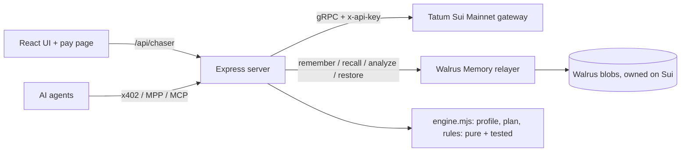

# Invoice Chaser

**An invoice tracker for freelancers paid in USDC on Sui. It learns how each client pays, and chases each one differently.**

**[Live demo](https://invoice-chaser-sigma.vercel.app)** · **[Demo video (2:08)](https://youtu.be/nCpQtlcQF-0)** · **[Blog post](https://dev.to/hudapugar/invoice-chaser-an-invoice-tool-that-learns-how-each-client-pays-walrus-memory-tatum-on-sui-ji7)** · **[Pitch deck (PDF)](https://github.com/PugarHuda/invoice-chaser/releases/download/demo-v4/invoice-chaser-deck.pdf)** · [X post](https://x.com/BangDropID/status/2117783225833869718)

Built for **Total Recall** (Tatum × Walrus Memory) · Track 03 Consumer Finance · started in [Tatum AI Builder](https://ai.tatum.io) ([prompts](docs/ai-builder/prompts.md), tag `ai-builder-v0`) · Sui Mainnet.

> Acme always pays 5 days late and ignores friendly nudges. Beta pays on the due date. Gamma short-pays by ~10%.
> Every invoicing tool treats them the same. Invoice Chaser remembers, and the reminder plan changes because of it.

## For judges: 5 minutes, no keys, no passcode

1. **[Open the dashboard](https://invoice-chaser-sigma.vercel.app/?app)** → Clients → **Acme**. Its learned profile (usual delay, which tone works, prediction error per invoice) is rebuilt from Walrus Memory on every boot.
2. Invoices → **inv-101** → flip **Ignore memory**. Without memory: a friendly reminder on 6 Nov. With memory: a formal one on 9 Nov, because formal reminders were followed by payment 4 of 4 times. The **Why?** panel links each memory it used to its Walrus blob.
3. Back on Acme, type a rule such as `never chase before the 20th` and press **Try it (no passcode)**. The real engine runs on Acme's memories plus your rule and shows the plan moving (inv-101: 10 Nov → 20 Nov). Nothing is saved; saving a rule needs the owner passcode, because Walrus memories are permanent.
4. **[/?tab=proof](https://invoice-chaser-sigma.vercel.app/?tab=proof)**: the live chain checkpoint, the Walrus durability audit, and the **memory-chain audit**, where every payment memory is re-checked against Sui.
5. **[A pay link](https://invoice-chaser-sigma.vercel.app/?pay=inv-101)**: what the client sees. It has a `sui:pay` QR code (Payment Kit, nonce = invoice), a wallet button, and a live checkpoint stream that flips the page to paid.

**About the history.** Aug–Oct 2026 is seeded (38 memories written by [`scripts/seed.mjs`](scripts/seed.mjs) in the app's own format). Each one carries `"seed": true` and is labelled in the UI. Everything since then is real: new invoices, reminders, rules and Mainnet payments.

## Why it is different

| | Invoice Chaser | Chaser / Kolleno (fiat collections) | Request Finance / Coinbase Business (crypto invoicing) |
|---|---|---|---|
| Predicts when each client pays | Yes | Yes | No public claim |
| Shows the evidence behind each prediction | **Each plan cites its Walrus memories** | No public claim | No public claim |
| Learned data re-checked against the chain | **Yes, every payment memory** | No (bank data) | No public claim |
| Reads the payer's wallet before chasing | **Yes (USDC on hand, recent activity)** | Impossible (bank balances are private) | No public claim |

All three need the same three pieces: memory the user owns (Walrus), payments on a public chain (Sui), and one gateway that reads both payer and payee live (Tatum). Sources and the full comparison are in [docs/DETAILS.md](docs/DETAILS.md#how-it-compares).

## How it uses Walrus Memory

- **System of record, not a log.** Each event is one memory: a sentence plus a machine tag (invoice sent, reminder + tone, payment + delay + payer, rule, promise). The server holds no data; it rebuilds clients, invoices and profiles from Walrus on boot ([`server/memory.mjs`](server/memory.mjs)).
- **The learning loop** ([`server/engine.mjs`](server/engine.mjs), pure and tested):
  - an EWMA of past delays predicts the pay date;
  - per-tone hit rates pick the tone;
  - rules and promises become hard constraints.
  - Acme's prediction error falls 4 → 2 → 0 → 0 days, and the error across all clients falls 1.5 → 0.3 days.
- **`analyze()`** turns a pasted client email into facts ("we only pay on Thursdays"). **Recall** has three ranking modes. **`restore()`** sits behind the Total Recall button.
- **Sharding** past 90 memories per client (recall caps at 100). **Incremental sync** uses the `listMemories` cursor.
- **Append-only revocation** (`rule_revoked`, `client_archived`).

## How it uses Tatum

All chain reads and writes go through **Tatum's Sui Mainnet gRPC gateway** ([`server/sui.mjs`](server/sui.mjs)). The main calls:

| Purpose | Tatum call |
|---|---|
| Verify a payment | `LedgerService.GetTransaction` (`balance_changes`, status, checkpoint) |
| Find payments nobody reported | `LedgerService.BatchGetObjects` on Payment Kit records (one call for all open invoices), `ListTransactions` for plain transfers |
| Re-prove every payment memory | `LedgerService.BatchGetTransactions` (one call per 50) |
| Can the payer pay now? | `StateService.ListBalances`, `ListTransactions` on the payer's wallet |
| Live pay page | `SubscriptionService.SubscribeCheckpoints`, filtered to the payee |
| Build, simulate, execute payments | `Transaction.build`, `SimulateTransaction`, `TransactionExecutionService` |
| Payer identity, zkLogin | `NameService.ReverseLookupName`, `SignatureVerificationService` |

Also used: the Tatum Data API (USD rates) and the Malicious Address API (payer screening). [`/proof`](https://invoice-chaser-sigma.vercel.app/api/chaser/proof) counts every gRPC call per method and names the provider that served it.

> **Tatum credits.** Two free accounts reached the 100,000-credit limit (4 Nov and 8 Nov). Following the organizers' rule, the app then falls back to the public Sui fullnode and says so. `/proof` shows `gatewayStatus: "quota_fallback"`, every label names the provider that actually served it, and each payment memory records `verified_via`. Tatum is retried every 10 minutes.

## Agent payments (x402 and MPP, settled on Sui Mainnet)

Every invoice is a payable HTTP resource. `GET /api/chaser/x402/<invoice>` answers 402 with x402 v1 and v2 terms. In v2 the server is the facilitator: it checks the signer, simulates through Tatum, requires the Payment Kit receipt for this invoice's nonce, then broadcasts. `GET /api/chaser/mpp/<invoice>` is the same invoice as an MPP charge. Reference agents are [`scripts/ap-agent.mjs`](scripts/ap-agent.mjs) and [`scripts/mpp-agent.mjs`](scripts/mpp-agent.mjs). Agents can also find everything without docs: `/openapi.json`, an MCP server with 12 tools, and Agent Skills.

## Live on Sui Mainnet

| What | Proof |
|---|---|
| x402 v2: the agent only signed, the server facilitated through Tatum | [BnnyNUwv…](https://suiscan.xyz/mainnet/tx/BnnyNUwvAYVqWT7bM2HAAWVRuPgoMckD6Tk2DzTqftFJ) |
| MPP charge with `Payment-Receipt` | [CrgvCr2F…](https://suiscan.xyz/mainnet/tx/CrgvCr2FoJXxuc3p3tuNorCSoPquSUeuuhHqu5tL8iG4) |
| Payment Kit payment nobody reported, found by sync | [G5r8eC1h…](https://suiscan.xyz/mainnet/tx/G5r8eC1hwTkrj4Dg7FFWTcP1P5LTJaRn8FvGUx7WbAJP) |
| Plain USDC transfer matched by its unique amount | [CzFhbHnE…](https://suiscan.xyz/mainnet/tx/CzFhbHnEY6ug3dauaPqmp6CsNkuwfTMtJEGPqRArqkqU) |
| Sponsored gas (the payer's SUI didn't move) | [8UkL1z4K…](https://suiscan.xyz/mainnet/tx/8UkL1z4KhCrta1zJfvfTsdZmMPss9jrTnNcceLGUgwCq) |
| Native gasless USDC (Address Balances) | [7oaYHYj2…](https://suiscan.xyz/mainnet/tx/7oaYHYj24aBSLs8QxTHg7zebAiZycCKkCF6vFPSMcLYA) |
| PDF receipt stored on Walrus | [blob](https://aggregator.walrus-mainnet.walrus.space/v1/blobs/maCqeFY1G5eSVx_ji5zrqXM308rCMUMY-nGWqBMNNPM) |

## Architecture



*AI proposes, code decides.* The engine is deterministic. An LLM only writes the wording of reminder drafts, around facts the server inserts.

## Run it

```bash
cp .env.example .env.local   # TATUM_API_KEY, MEMWAL_PRIVATE_KEY, MEMWAL_ACCOUNT_ID, SUI_PAYEE_ADDRESS
npm install && npm run build && npm run dev   # http://localhost:3000, Node 22+
npm run lint && npm run typecheck && npm test # 44 unit/integration tests
npx playwright test                            # E2E on 6 browsers/devices, never writes a memory
```

CI ([`.github/workflows/ci.yml`](.github/workflows/ci.yml)) runs lint, typecheck, tests, build and `npm audit` on every push. It then runs Playwright against production once production serves the same commit.

## More

Everything else is in **[docs/DETAILS.md](docs/DETAILS.md)**:
- payments: gasless and sponsored payments, swap-and-pay with SUI, Slush pay links, partial payments, payment terms (discount and late fee), promises to pay;
- documents and integrations: Factur-X e-invoices, email reminders and Xero sync;
- agents: the MCP tools, agent discovery;
- operations: security hardening, the test matrix, private mode and known limits.

Build reports are in [docs/reports](docs/reports).

MIT License.
