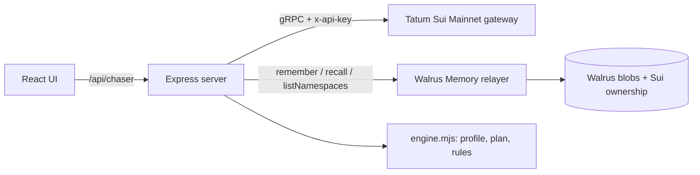

# Invoice Chaser

**An invoice tracker for freelancers paid in USDC on Sui that learns how each client pays, and chases each one differently.**

**Live demo: https://invoice-chaser-sigma.vercel.app** (open `/`, then Clients → Acme, Invoices → inv-101, /proof)

Built for **Total Recall** (Tatum × Walrus Memory, 20 Oct – 10 Nov 2026) · Track 03 Consumer Finance · started in [Tatum AI Builder](https://ai.tatum.io) (see [`docs/ai-builder/prompts.md`](docs/ai-builder/prompts.md), tag `ai-builder-v0`).

> Acme always pays 5 days late and ignores friendly nudges. Beta pays on the due date. Gamma short-pays by ~10%.
> Every invoicing tool treats them the same. Invoice Chaser remembers, and the reminder plan changes because of it.

## What it does

1. **Issue a USDC invoice** and send the client a **pay link** (`/?pay=<invoice>`): a payer-only page with a real `sui:pay` QR code (Sui Payment Kit URI) that shows nothing about how you see them.
2. **Get paid on Sui Mainnet through the Sui Payment Kit**: the client scans the QR, clicks *Connect Sui wallet & pay* (the registry payment is built server-side through Tatum), or pays manually and pastes the digest. Payments go through the shared Payment Kit **registry with nonce = invoice id**, so the chain itself refuses a second payment for the same invoice, and the app finds the payment by invoice without anyone reporting a digest (`/sync-payments`). Every path is verified through **Tatum's gRPC gateway** (`balance_changes`) and settles the invoice as paid or partial; the payer's wallet (and SuiNS name) is remembered, and a payment from a wallet this client never used before is flagged.
3. **Partial payments, payer checks**: a short payment leaves a remaining balance; the pay page, x402 terms and registry lookup then ask for exactly what's still owed. Each client can have an expected payer wallet (0x… or a **SuiNS** name resolved through Tatum); payments from any other wallet are flagged, and every payer is screened with **Tatum's Malicious Address API** ("clean" = not in Tatum's scam feeds).
4. **Remember everything in Walrus Memory**: invoices, reminders (with tone), payments (delay, amount, payer), your own rules ("never chase Acme before the 10th"), and facts that Walrus `analyze()` extracts from a pasted client email ("we only pay on Thursdays, never before the 15th").
5. **Plan the next reminder from memory**: predicted pay date (EWMA of past delays), the tone that actually worked for this client, your hard rules. A **"Why?" panel** cites the exact memories behind the decision (each linked to its Walrus blob), every logged reminder stores which memories its plan cited, and an **"Ignore memory"** switch shows what a memory-less tool would do.

## How it learned (same invoice, two plans)

| inv-101 · Acme · due 5 Nov | Ignore memory | With Walrus Memory |
|---|---|---|
| First reminder | 6 Nov, friendly | **9 Nov, formal** |
| Predicted payment | — | **10 Nov** (EWMA of 4 paid invoices: +4, +6, +5, +5 days) |
| Why | default schedule | formal reminders were followed by payment within 3 days 4/4 times; friendly 1/3 |

The Today page shows the same evidence for the whole book: mean prediction error on each client's first invoice vs their latest. CSV export (`/api/chaser/export.csv`) carries every invoice with its on-chain receipt.

Prediction error for Acme, invoice by invoice: **4 → 2 → 0 → 0 days** (`computeProfile().history`, covered by tests).

## How it uses Walrus Memory

Walrus Memory is the **system of record**, not a log on the side.

- Every event is one memory: a human sentence plus a machine tag, e.g.
  `Acme Corp paid inv-095 in full (3500.002202 USDC) on 2026-10-20, 5 day(s) after due… \n#ic {"type":"invoice_paid","delay_days":5,"reminders":1,"last_tone":"formal",…}`
- One namespace per client (`ic:main:client:<id>`), so each stays far below the 100-record recall window.
- **On boot the server holds no data.** It lists the `ic:main:*` namespaces, recalls each one and rebuilds clients, invoices and learned profiles from Walrus ([`server/memory.mjs`](server/memory.mjs)). The **Total Recall** button does the same on demand: wipe local state, rebuild from Walrus.
- **`analyze()`**: paste an email or call notes on a client page; the relayer extracts each fact and stores it as its own memory. Scheduling rules inside them ("only pay on Thursdays" = predicted pay day; "never before the 15th" = no reminder before then) become hard constraints, even for a client with no payment history.
- **Semantic recall search**: every client page has an *Ask this memory* box (`/clients/:id/search`): Walrus recall ranks that client's memories by meaning (cosine distance shown), e.g. "what tone works for them?".
- **`restore()`**: the Total Recall button first asks the relayer to re-index every blob it holds per namespace, then recalls everything.
- Writes are queued in the background (a mainnet write takes ~25 s) with retries; the UI shows *writing to Walrus…* until the relayer confirms, then links the blob on Walruscan. Nothing is shown as saved before it is.

## How it uses Tatum

All chain reads go through **Tatum's Sui Mainnet gRPC gateway** (`sui-mainnet-grpc.gateway.tatum.io:443`, `x-api-key`), using `SuiGrpcClient` from `@mysten/sui` over native gRPC ([`server/sui.mjs`](server/sui.mjs)):

| Purpose | Call |
|---|---|
| Verify an invoice payment | `LedgerService.GetTransaction` → `effects.status`, `balance_changes`, `timestamp` |
| Detect incoming USDC | `StateService.GetBalance` (balance watcher, `/api/chaser/cron-check`) |
| Live proof | `LedgerService.GetCheckpoint` (latest) |
| Build the payer's USDC transfer (coin selection, gas price, budget) | `Transaction.build` through the same gateway (`/api/chaser/pay-tx`) |
| Execute an agent-signed payment | `TransactionExecutionService` (`scripts/ap-agent.mjs`) |
| Build the Payment Kit registry payment for a wallet / agent | `processRegistryPayment` built through the gateway (`/api/chaser/pay-tx`) |
| Find an invoice's payment with no digest | Payment Kit registry dynamic field `PaymentKey<USDC>{nonce, amount, receiver}` (`/api/chaser/sync-payments`) |
| Payer recognition | `GetTransaction` → `transaction.sender`, `NameService.ReverseLookupName` (SuiNS) |
| Real network fee before the payer signs | `SimulateTransaction` on the built Payment Kit tx (gas used − storage rebate) |
| SUI → USDC for an agent short on USDC | Cetus aggregator route, transaction built and executed through the gateway (`server/swap.mjs`) |
| USD prices | **Tatum Data API** `GET /v4/data/rate/symbol` (SUI, USDC) on /proof and fee display |

Sui JSON-RPC is deprecated, and gRPC has no "transactions by address" query. The Payment Kit registry solves that: a payment is a record keyed by the invoice, so we look it up directly. Unique amounts remain as the fingerprint for plain transfers. Calls are throttled under the free tier's 3 req/s, and 429s / reset channels are retried with backoff.

> Note: `@mysten/payment-kit`'s `getPaymentRecord` builds a malformed type name (`PaymentKey<phantom T><coin>`), so `server/sui.mjs` looks the dynamic field up directly.

## Agent payments (x402 on Sui)

Every invoice is also a payable HTTP resource for accounts-payable agents:

```
GET /api/chaser/x402/<invoice>            -> 402 { x402Version: 1, accepts: [{ scheme: "exact", network: "sui:mainnet",
                                               asset: <USDC>, maxAmountRequired, payTo, resource, ... }] }
GET /api/chaser/x402/<invoice>            -> 200 receipt   (with  X-PAYMENT: <Sui tx digest>)
    X-PAYMENT: <digest>
```

The 402 terms also carry `extra.paymentKit = { registry, registryId, nonce }` and a `sui:pay` URI, so an agent pays through the Payment Kit registry and the chain rejects a second payment. The server verifies the digest through Tatum exactly like a human payment (success, USDC to `payTo`, unique amount, newer than the invoice, never used before), answers with an `X-PAYMENT-RESPONSE` header, and the payment is remembered with `channel: "x402"`. [`scripts/ap-agent.mjs`](scripts/ap-agent.mjs) is a reference agent: reads the 402 terms, enforces its own budget, builds and signs the USDC transfer, executes it through Tatum, retries with `X-PAYMENT`.

```bash
AP_AGENT_KEY=suiprivkey1... AP_MAX_USDC=1 node --env-file=.env.local scripts/ap-agent.mjs https://invoice-chaser-sigma.vercel.app/api/chaser/x402/<invoice>
```

## Tested end to end on Sui Testnet

`SUI_NETWORK=testnet` switches the Tatum gateway, the USDC type (Circle testnet USDC) and the Payment Kit package; `MEMWAL_NS_PREFIX=ic:test:` keeps test memories out of the demo. [`scripts/e2e-testnet.mjs`](scripts/e2e-testnet.mjs) runs against a live server and checks, on-chain:

1. an x402 agent pays an invoice through the Payment Kit registry and gets a 200 receipt (first run: [tx](https://suiscan.xyz/testnet/tx/CTXc9cDKTXBJFDJjf1pwip43cVY7TB7eyuGWTyKeyqwD));
2. a paid invoice no longer asks for payment;
3. the registry **rejects a second payment** for the same invoice;
4. a payment nobody reported is found through the registry and settled automatically;
5. replaying a used digest on another invoice is rejected; malformed input is rejected;
6. the payment memory records the payer wallet and channel;
7. a partial payment leaves a remaining balance and the pay page asks only for that;
8. the remaining balance, paid through the registry, auto-settles the invoice;
9. a payment from a wallet other than the client's expected payer is flagged, and the payer is screened by Tatum.

```bash
SUI_NETWORK=testnet MEMWAL_NS_PREFIX=ic:test: PORT=3088 node --env-file=.env.local server/index.mjs
SUI_NETWORK=testnet node --env-file=.env.local --env-file=.env.testagent scripts/e2e-testnet.mjs http://localhost:3088 <paid-invoice>
```

## Hardening

- Per-IP write / payment / search budgets (429 + `Retry-After`); on Vercel the IP comes from the edge header, never the client-supplied `X-Forwarded-For`.
- Input validation (real calendar dates, amounts 0.01–1,000,000 with ≤2 decimals, length caps), JSON errors for malformed bodies.
- `robots.txt` and an [`llms.txt`](https://invoice-chaser-sigma.vercel.app/llms.txt) that tells AI agents how to pay an invoice over x402. Lighthouse: Accessibility 100, SEO 100.

## For judges

The Today page has a five-stop tour: Acme's learned profile → memory on vs off → teach a rule → pay on Sui Mainnet → live proof.

## Architecture



- `server/engine.mjs`: pure logic (state derivation, profile, plan, preference parser). *AI proposes, code decides*: every number is deterministic and tested.
- `server/memory.mjs`: Walrus Memory store, write queue, Total Recall loader.
- `server/sui.mjs`: Tatum gRPC client.
- `server/routes/chaser.mjs`: API.
- `src/App.tsx`: UI (generated by Tatum AI Builder, then wired to the real API).

## What's real and what's seeded

| | |
|---|---|
| Walrus Memory writes/reads | **Real**, Mainnet relayer. |
| Tatum gRPC (checkpoint, balance, tx verification) | **Real**, Sui Mainnet. |
| Client history Aug–Oct 2026 (38 memories) | **Seeded** with [`scripts/seed.mjs`](scripts/seed.mjs) in the app's own format; each carries `"seed": true` and is labelled in the UI. Seeded payments have no digest. |
| New invoices, reminders, rules, payments made in the app | **Real** memories; payments verified on Mainnet. |

## Run it

```bash
cp .env.example .env.local   # TATUM_API_KEY, MEMWAL_PRIVATE_KEY, MEMWAL_ACCOUNT_ID, SUI_PAYEE_ADDRESS
npm install
npm test                     # engine tests
npm run seed -- --dry        # preview demo history (run without --dry once, on a fresh namespace prefix)
npm run dev                  # http://localhost:3000
```

Node 22+. Set `MEMWAL_NS_PREFIX` to use a different namespace prefix.

## Known limits

- Reminders are drafted, logged and opened in your email app (`mailto:` with the pay link); the app does not send email itself.
- Rules are parsed from the sentence (yours, or a fact extracted by Walrus `analyze()`) with a small rule set: day-of-month, pay weekdays, skip weekdays, weekends, tone.
- Recall caps at 100 memories per namespace, which is plenty for one client but would need paging for heavy users.
- The default relayer sees memory plaintext (it does encryption and embeddings). Memories hold client aliases and amounts only, no emails. `MemWalManual` would keep plaintext client-side.

- Payments through the Payment Kit registry cannot be duplicated (enforced on-chain). For a *plain* transfer settled by pasted digest, replay protection is per process (in-flight lock + every digest already in memory); two serverless instances verifying the same digest at the same moment could both accept it, limited by the unique-amount rule to one invoice's exact amount.
- If the process dies before a Walrus write finishes, that memory is lost; a payment made through the registry is recovered by the next `/sync-payments`.

## License

MIT
