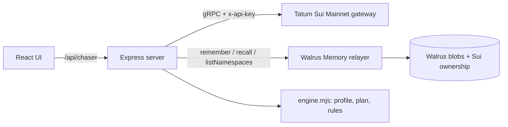

# Invoice Chaser

**An invoice tracker for freelancers paid in USDC on Sui that learns how each client pays, and chases each one differently.**

**Live demo: https://invoice-chaser-sigma.vercel.app** (open `/`, then Clients → Acme, Invoices → inv-101, /proof)

Built for **Total Recall** (Tatum × Walrus Memory, 20 Oct – 10 Nov 2026) · Track 03 Consumer Finance · started in [Tatum AI Builder](https://ai.tatum.io) (see [`docs/ai-builder/prompts.md`](docs/ai-builder/prompts.md), tag `ai-builder-v0`).

> Acme always pays 5 days late and ignores friendly nudges. Beta pays on the due date. Gamma short-pays by ~10%.
> Every invoicing tool treats them the same. Invoice Chaser remembers, and the reminder plan changes because of it.

## What it does

1. **Issue a USDC invoice** and send the client a **pay link** (`/?pay=<invoice>`): a payer-only page with a real `sui:pay` QR code (Sui Payment Kit URI) that shows nothing about how you see them.
2. **Get paid on Sui Mainnet through the Sui Payment Kit**: the client scans the QR, clicks *Connect Sui wallet & pay* (the registry payment is built server-side through Tatum), or pays manually and pastes the digest. Payments go through the shared Payment Kit **registry with nonce = invoice id**, so the chain itself refuses a second payment for the same invoice, and the app finds the payment by invoice without anyone reporting a digest (`/sync-payments`). Every path is verified through **Tatum's gRPC gateway** (`balance_changes`) and settles the invoice as paid or partial; the payer's wallet (and SuiNS name) is remembered, and a payment from a wallet this client never used before is flagged.
3. **Partial payments, payer checks**: a short payment leaves a remaining balance; the pay page, x402 terms and registry lookup then ask for exactly what's still owed. Each client can have an expected payer wallet (0x… or a **SuiNS** name resolved through Tatum); payments from any other wallet are flagged, and every payer is screened with **Tatum's Malicious Address API** ("clean" = not in Tatum's scam feeds).
4. **Remember everything in Walrus Memory**: invoices, reminders (with tone), payments (delay, amount, payer), your own rules ("never chase Acme before the 10th"), and facts that Walrus `analyze()` extracts from a pasted client email ("we only pay on Thursdays, never before the 15th").
5. **Plan the next reminder from memory**: predicted pay date (EWMA of past delays), the tone that actually worked for this client, your hard rules. A **"Why?" panel** cites the exact memories behind the decision (each linked to its Walrus blob), every logged reminder stores which memories its plan cited, and an **"Ignore memory"** switch shows what a memory-less tool would do.

## How it learned (same invoice, two plans)

| inv-101 · Acme · due 5 Nov | Ignore memory | With Walrus Memory |
|---|---|---|
| First reminder | 6 Nov, friendly | **9 Nov, formal** |
| Predicted payment | — | **10 Nov** (EWMA of 4 paid invoices: +4, +6, +5, +5 days) |
| Why | default schedule | formal reminders were followed by payment within 3 days 4/4 times; friendly 1/3 |

The Today page shows the same evidence for the whole book: mean prediction error on each client's first invoice vs their latest. CSV export (`/api/chaser/export.csv`) carries every invoice with its on-chain receipt.

Prediction error for Acme, invoice by invoice: **4 → 2 → 0 → 0 days** (`computeProfile().history`, covered by tests).

## How it uses Walrus Memory

Walrus Memory is the **system of record**, not a log on the side.

- Every event is one memory: a human sentence plus a machine tag, e.g.
  `Acme Corp paid inv-095 in full (3500.002202 USDC) on 2026-10-20, 5 day(s) after due… \n#ic {"type":"invoice_paid","delay_days":5,"reminders":1,"last_tone":"formal",…}`
- One namespace per client (`ic:main:client:<id>`), **sharded** once it holds 90 memories (`…/1`, `…/2`, …). `recall()` returns at most 100 records per namespace, so a long-lived client would otherwise hit a hard ceiling where payments refuse to settle. Writes go to the newest shard, reads and semantic search union all shards, and history can grow without limit.
- **Durability audit** on [`/proof`](https://invoice-chaser-sigma.vercel.app/api/chaser/proof): `listMemories()` walks the relayer's full inventory (active count, anything saved locally but missing, earliest storage expiry and Walrus end epochs), and the newest blobs are fetched straight from a Walrus aggregator, independent of the relayer.
- **On boot the server holds no data.** It lists the `ic:main:*` namespaces, recalls each one and rebuilds clients, invoices and learned profiles from Walrus ([`server/memory.mjs`](server/memory.mjs)). The **Total Recall** button does the same on demand: wipe local state, rebuild from Walrus.
- **`analyze()`**: paste an email or call notes on a client page; the relayer extracts each fact and stores it as its own memory. Scheduling rules inside them ("only pay on Thursdays" = predicted pay day; "never before the 15th" = no reminder before then) become hard constraints, even for a client with no payment history.
- **Semantic recall search**: every client page has an *Ask this memory* box (`/clients/:id/search`): Walrus recall ranks that client's memories by meaning (cosine distance shown), e.g. "what tone works for them?".
- **`restore()`**: the Total Recall button first asks the relayer to re-index every blob it holds per namespace, then recalls everything.
- Writes are queued in the background (a mainnet write takes ~25 s) with retries; the UI shows *writing to Walrus…* until the relayer confirms, then links the blob on Walruscan. Nothing is shown as saved before it is.

## How it uses Tatum

All chain reads go through **Tatum's Sui Mainnet gRPC gateway** (`sui-mainnet-grpc.gateway.tatum.io:443`, `x-api-key`), using `SuiGrpcClient` from `@mysten/sui` over native gRPC ([`server/sui.mjs`](server/sui.mjs)):

| Purpose | Call |
|---|---|
| Verify an invoice payment | `LedgerService.GetTransaction` → `effects.status`, `balance_changes`, `timestamp` |
| Detect incoming USDC | `StateService.GetBalance` (balance watcher, `/api/chaser/cron-check`) |
| Live proof | `LedgerService.GetCheckpoint` (latest) |
| Build the payer's USDC transfer (coin selection, gas price, budget) | `Transaction.build` through the same gateway (`/api/chaser/pay-tx`) |
| Execute an agent-signed payment | `TransactionExecutionService` (`scripts/ap-agent.mjs`) |
| Build the Payment Kit registry payment for a wallet / agent | `processRegistryPayment` built through the gateway (`/api/chaser/pay-tx`) |
| Find an invoice's payment with no digest | Payment Kit registry dynamic field `PaymentKey<USDC>{nonce, amount, receiver}` (`/api/chaser/sync-payments`) |
| Payer recognition | `GetTransaction` → `transaction.sender`, `NameService.ReverseLookupName` (SuiNS) |
| Real network fee before the payer signs | `SimulateTransaction` on the built Payment Kit tx (gas used − storage rebate) |
| SUI → USDC for an agent short on USDC | Cetus aggregator route, transaction built and executed through the gateway (`server/swap.mjs`) |
| USD prices | **Tatum Data API** `GET /v4/data/rate/symbol` (SUI, USDC) on /proof and fee display |

Sui JSON-RPC is deprecated, and gRPC has no "transactions by address" query. The Payment Kit registry solves that: a payment is a record keyed by the invoice, so we look it up directly. Unique amounts remain as the fingerprint for plain transfers. Calls are throttled under the free tier's 3 req/s, and 429s / reset channels are retried with backoff.

> Note: `@mysten/payment-kit`'s `getPaymentRecord` builds a malformed type name (`PaymentKey<phantom T><coin>`), so `server/sui.mjs` looks the dynamic field up directly.

## Agent payments (x402 on Sui)

Every invoice is also a payable HTTP resource for accounts-payable agents:

```
GET /api/chaser/x402/<invoice>            -> 402 { x402Version: 1, accepts: [{ scheme: "exact", network: "sui:mainnet",
                                               asset: <USDC>, maxAmountRequired, payTo, resource, ... }] }
GET /api/chaser/x402/<invoice>            -> 200 receipt   (with  X-PAYMENT: <Sui tx digest>)
    X-PAYMENT: <digest>
```

The 402 terms also carry `extra.paymentKit = { registry, registryId, nonce }` and a `sui:pay` URI, so an agent pays through the Payment Kit registry and the chain rejects a second payment. The server verifies the digest through Tatum exactly like a human payment (success, USDC to `payTo`, unique amount, newer than the invoice, never used before), answers with an `X-PAYMENT-RESPONSE` header, and the payment is remembered with `channel: "x402"`. [`scripts/ap-agent.mjs`](scripts/ap-agent.mjs) is a reference agent: reads the 402 terms, enforces its own budget, builds and signs the USDC transfer, executes it through Tatum, retries with `X-PAYMENT`.

```bash
AP_AGENT_KEY=suiprivkey1... AP_MAX_USDC=1 node --env-file=.env.local scripts/ap-agent.mjs https://invoice-chaser-sigma.vercel.app/api/chaser/x402/<invoice>
```

### x402 v2: the server is the facilitator

Signatures are checked with Tatum's gRPC client attached, so zkLogin wallets (for example Slush with Google sign-in) verify against the current JWKs and epoch through Tatum's `SignatureVerificationService`. Without it they would be refused as invalid. A wrong signer, a malformed signature or a bad transaction is refused before any network call.


The same endpoint also speaks [x402 v2](https://github.com/x402-foundation/x402/tree/main/specs) (`exact` scheme on Sui). Every 402 carries the v2 requirements base64-encoded in a `PAYMENT-REQUIRED` header (CAIP-2 `sui:mainnet`, amount in base units, USDC, `payTo`, Payment Kit nonce in `extra`). A v2 agent doesn't broadcast anything: it sends `PAYMENT-SIGNATURE` = `{ x402Version: 2, accepted, payload: { signature, transaction } }`. The server acts as the facilitator through Tatum. It checks that the signer is the transaction's sender, simulates the transaction to see exactly what it would move, and requires a Payment Kit `PaymentReceipt` for **this** invoice's nonce, so the chain itself rejects a second payment even if two submissions race. Only then does it broadcast, settle into Walrus Memory, and answer with a `PAYMENT-RESPONSE` header (`success`, `transaction`, `network`, `payer`). One settlement per invoice at a time; refuses while memory isn't fully loaded. `scripts/ap-agent.mjs` speaks v2 when offered (`--v1` for the old flow). **On Mainnet:** [tx](https://suiscan.xyz/mainnet/tx/BnnyNUwvAYVqWT7bM2HAAWVRuPgoMckD6Tk2DzTqftFJ) for `inv-mw1iflmeba52e5`; the agent only signed.

### MPP (Machine Payments Protocol) on the same invoice

The invoice is also an [MPP](https://mpp.dev) charge, using [`@suimpp/mpp`](https://www.npmjs.com/package/@suimpp/mpp) + `mppx`:

```
GET /api/chaser/mpp/<invoice>   -> 402  WWW-Authenticate: Payment method="sui", intent="charge", request=<amount, USDC, payee>, opaque=<invoice>
GET /api/chaser/mpp/<invoice>   -> 200  (Authorization: Payment <credential: digest + payer signature>) + Payment-Receipt
```

The challenge is HMAC-bound to the invoice (`MPP_SECRET_KEY`). `@suimpp/mpp` checks the transfer and the payer's grief-protection signature (signer must equal the on-chain sender); its replay store is backed by the digests already settled in Walrus Memory. Then the digest goes through the same Tatum verify/settle path as every other payment and is remembered with `channel: "mpp"`. Reference agent: [`scripts/mpp-agent.mjs`](scripts/mpp-agent.mjs) reads the challenge, enforces a budget and lets `mppx` pay. **On Mainnet:** the agent paid `inv-mw1g529i869ccd` over MPP and got a `Payment-Receipt` ([tx](https://suiscan.xyz/mainnet/tx/CrgvCr2FoJXxuc3p3tuNorCSoPquSUeuuhHqu5tL8iG4)). The payer side builds through the public fullnode because `mppx` makes several RPC calls back to back, more than Tatum's free-tier 3 rps allows; the server still verifies through Tatum.

```bash
AP_AGENT_KEY=suiprivkey1... AP_MAX_USDC=1 node --env-file=.env.local scripts/mpp-agent.mjs https://invoice-chaser-sigma.vercel.app/api/chaser/mpp/<invoice>
```

## Agents can find it on their own (discovery)

An agent that only knows the domain can find every way to pay. Each link below is generated from live config, and each one is checked by the [isitagentready.com](https://isitagentready.com) scanner (it went from 2 to 11 passing checks, including MPP discovery):

- [`/openapi.json`](https://invoice-chaser-sigma.vercel.app/openapi.json) is the MPP service discovery document ([draft-payment-discovery-01](https://github.com/tempoxyz/mpp-specs)). Both payable operations (`/mpp/{id}`, `/x402/{id}`) carry `x-payment-info` offers. The amount is `null` (dynamic pricing) because every invoice has its own unique micro-USDC amount.
- [`/.well-known/api-catalog`](https://invoice-chaser-sigma.vercel.app/.well-known/api-catalog) (RFC 9727 linkset) and RFC 8288 `Link` headers on every page.
- The [MCP server card](https://invoice-chaser-sigma.vercel.app/.well-known/mcp/server-card.json) (SEP-1649), so clients find the MCP endpoint and its tools.
- The [Agent Skills index](https://invoice-chaser-sigma.vercel.app/.well-known/agent-skills/index.json) with a real `pay-invoice` SKILL.md (sha256 digest). The skill walks an agent through paying over MPP or x402.
- **WebMCP**: the page registers its read tools with `document.modelContext`, so an AI agent in the browser can call them directly: invoice terms, open a pay page, list invoices, client profile, memory search.
- `Accept: text/markdown` on a page, or on a pay link (`/?pay=inv-101`), returns markdown instead of the SPA shell. The pay link answers with that invoice's MPP, x402 and live endpoints.
- `robots.txt` with Content Signals, plus `sitemap.xml`. Unknown `/api/*` and `/.well-known/*` paths are real JSON 404s, not soft-404 HTML.

## Payments nobody reported (reconciliation)

Many clients pay from an exchange or a wallet that knows nothing about Payment Kit. They send the exact amount and close the tab. Tatum Notifications does not cover Sui yet (checked against `GET /v4/subscription/chains`), so sync covers this case itself with Tatum's gRPC gateway:

- `LedgerService.ListTransactions` with an `affected_address` filter on the payee, newest first. This is the raw gRPC call, because the SDK wrapper only exposes sender and move-call filters.
- Each transaction's `balance_changes` show the exact USDC received. An unsent invoice settles when a transaction carries its unique micro-amount, is not older than the invoice, and its digest was never used. Every candidate still goes through the normal Tatum verify-and-settle path.
- Mainnet proof: invoice `inv-mw25p3mw60f829` was paid by a plain USDC transfer that was never reported, and sync settled it as channel `reconcile` ([tx CzFhbHnE…](https://suiscan.xyz/mainnet/tx/CzFhbHnEY6ug3dauaPqmp6CsNkuwfTMtJEGPqRArqkqU), checkpoint 341573132). The script is [`scripts/plain-transfer-pay.mjs`](scripts/plain-transfer-pay.mjs). The first sync after deploy checked 4 open invoices against the payee's history and matched none of the older transfers.

## Real-time payments: Tatum gRPC checkpoint stream

An open pay page subscribes to `GET /api/chaser/pay/<invoice>/live` (Server-Sent Events). The server holds one `SubscriptionService.SubscribeCheckpoints` stream on Tatum's Sui gateway per instance, shared by every open page, and matches each checkpoint's `balance_changes` against the watched (payee, exact micro-amount) pairs. On a hit the digest runs through the normal verify/settle path, and the page flips to paid at the checkpoint where the money landed. No polling, no pasted digest. Each stream window lasts 4 minutes, after which the browser's EventSource reconnects. The daily cron still covers payments made while no page was open. **On Mainnet:** the stream saw the sponsored payment above at checkpoint 341405407 and settled it before the wallet flow's own verify call arrived.

## Gas-free payments for clients (sponsored transactions)

With a gas wallet configured (`GAS_SPONSOR_KEY`, or the receipts storage wallet as a fallback), `/pay-tx` builds the Payment Kit transaction with the payer as sender and the server's wallet as **gas owner**, then MACs the bytes. The payer's wallet only signs (`sui:signTransaction`); `/pay-sponsored` checks the MAC, adds the sponsor signature server-side (it never leaves the server), submits both through Tatum and settles the payment. A client needs USDC and nothing else. Both signatures cover exactly the bytes the server built, so the endpoint can't be used to sponsor anything else. Each payment's gas budget is capped (`SPONSOR_MAX_MIST`, default 0.02 SUI). If sponsorship isn't available, the wallet pays gas as before. **On Mainnet:** `inv-mw1g53lda74512` (0.019753 USDC) was paid by a wallet whose SUI balance didn't move; the gas owner is the server's wallet ([tx](https://suiscan.xyz/mainnet/tx/8UkL1z4KhCrta1zJfvfTsdZmMPss9jrTnNcceLGUgwCq)). [`scripts/sponsored-pay.mjs`](scripts/sponsored-pay.mjs) replays the pay page's wallet flow.

## Revoking what it learned

Walrus is append-only, so "forget this rule" is itself a memory: `rule_revoked` names the rule's text, and the engine ignores any rule written before its revocation (saving it again revives it). The client page lists live rules with a Revoke button and shows revoked ones struck through. The original memory stays on Walrus as history.

## Live on Sui Mainnet

| What happened | Proof |
|---|---|
| An x402 agent hit `inv-mvzyioev`, got `402`, swapped SUI -> USDC through the Cetus aggregator (via Tatum), paid through the Payment Kit registry, retried with `X-PAYMENT` and got a `200` receipt | [swap](https://suiscan.xyz/mainnet/tx/3vpeRNsKxvWSN5xykrsskxRw31Pt3rq6f7r6NjU6Rk5N) · [payment](https://suiscan.xyz/mainnet/tx/4BTevagvT34X166FBGsqj9tQSxisY1PDGwXXtrxLSC3z) |
| `inv-mvzyinun` was paid through the Payment Kit registry and **nobody told the app**; the production `/sync-payments` found it by invoice nonce and settled it | [swap](https://suiscan.xyz/mainnet/tx/3kYawfmx4W7dKGJEoa6VNA6J8iNtZUrn6pFTNLwjNzfC) · [payment](https://suiscan.xyz/mainnet/tx/G5r8eC1hwTkrj4Dg7FFWTcP1P5LTJaRn8FvGUx7WbAJP) |

Both payments are now memories in Delta Studio's Walrus namespace (`ic:main:client:c4`), visible in the app's timeline with links to their blobs.

## Beyond memory: Walrus storage and Walrus Sites

- **PDF receipts on Walrus.** A paid invoice gets a "Store PDF receipt on Walrus" button: the server renders the receipt (pdf-lib, every payment with its Suiscan link), stores it as a non-deletable blob for 26 epochs (~1 year) through the Mysten upload relay, and remembers the blob id in the client's Walrus Memory namespace, so a Total Recall rebuild finds it again. The payer sees the same link on the public pay page. Example on Mainnet: [receipt for inv-mvzyioev](https://aggregator.walrus-mainnet.walrus.space/v1/blobs/maCqeFY1G5eSVx_ji5zrqXM308rCMUMY-nGWqBMNNPM). A dedicated storage wallet (`WALRUS_STORAGE_KEY`) pays in WAL; it was funded by swapping SUI -> WAL through the Cetus aggregator.
- **The UI is also a Walrus Site.** The same React build (with `VITE_API_BASE` pointing at the API) is published with `site-builder` on Mainnet: site object `0x980e107e8226a9229fafb1b6cfb1378bc7dcf9fe409a69125cbf6f8ab9e569d0`. The API allows `*.wal.app` origins.

## Reminders, calendar and automation

- **Reminder drafts from memory (Vercel AI Gateway).** The engine picks tone and date; an LLM (`anthropic/claude-haiku-5.5`, OIDC auth on Vercel) writes the words from the memories the plan cited. It only writes prose around placeholders; the server inserts the invoice id, amount, due date and pay link, and rejects any draft containing a link, number or address. Without gateway access it falls back to a template and says so.
- **Calendar.** `GET /api/chaser/reminders.ics` exports every open invoice's memory-driven plan (Acme's reminders land after the 10th because of its rule).
- **Daily cron.** Vercel Cron calls `/api/chaser/cron/sync` (guarded by `CRON_SECRET`) to settle Payment Kit payments nobody reported.

## Use the memory from Claude / Cursor (MCP)

Invoice Chaser is also an MCP server (Streamable HTTP, stateless, read-only): any agent can ask what it has learned.

```bash
claude mcp add --transport http invoice-chaser https://invoice-chaser-sigma.vercel.app/api/chaser/mcp
```

Tools: `list_open_invoices`, `client_profile`, `plan_reminder`, `search_client_memory` (Walrus recall), `payment_terms` (x402 + Payment Kit + `sui:pay`), `learning_summary`. `node scripts/mcp-smoke.mjs <base-url>` exercises all of them with the official MCP client.

## Tested end to end on Sui Testnet

`SUI_NETWORK=testnet` switches the Tatum gateway, the USDC type (Circle testnet USDC) and the Payment Kit package; `MEMWAL_NS_PREFIX=ic:test:` keeps test memories out of the demo. [`scripts/e2e-testnet.mjs`](scripts/e2e-testnet.mjs) runs against a live server and checks, on-chain:

1. an x402 agent pays an invoice through the Payment Kit registry and gets a 200 receipt (first run: [tx](https://suiscan.xyz/testnet/tx/CTXc9cDKTXBJFDJjf1pwip43cVY7TB7eyuGWTyKeyqwD));
2. a paid invoice no longer asks for payment;
3. the registry **rejects a second payment** for the same invoice;
4. a payment nobody reported is found through the registry and settled automatically;
5. replaying a used digest on another invoice is rejected; malformed input is rejected;
6. the payment memory records the payer wallet and channel;
7. a partial payment leaves a remaining balance and the pay page asks only for that;
8. the remaining balance, paid through the registry, auto-settles the invoice;
9. a payment from a wallet other than the client's expected payer is flagged, and the payer is screened by Tatum;
10. a Payment Kit payment made for one invoice cannot be used to settle another (nonce bound through the registry).

```bash
SUI_NETWORK=testnet MEMWAL_NS_PREFIX=ic:test: PORT=3088 node --env-file=.env.local server/index.mjs
SUI_NETWORK=testnet node --env-file=.env.local --env-file=.env.testagent scripts/e2e-testnet.mjs http://localhost:3088 <paid-invoice>
```

## Hardening

- Per-IP write / payment / search budgets (429 + `Retry-After`); on Vercel the IP comes from the edge header, never the client-supplied `X-Forwarded-For`.
- Input validation (real calendar dates, amounts 0.01–1,000,000 with ≤2 decimals, length caps), JSON errors for malformed bodies.
- `robots.txt` and an [`llms.txt`](https://invoice-chaser-sigma.vercel.app/llms.txt) that tells AI agents how to pay an invoice over x402. Lighthouse: Accessibility 100, SEO 100.

## For judges

The Today page has a five-stop tour: Acme's learned profile → memory on vs off → teach a rule → pay on Sui Mainnet → live proof.

## Architecture



- `server/engine.mjs`: pure logic (state derivation, profile, plan, preference parser). *AI proposes, code decides*: every number is deterministic and tested.
- `server/memory.mjs`: Walrus Memory store, write queue, Total Recall loader.
- `server/sui.mjs`: Tatum gRPC client.
- `server/routes/chaser.mjs`: API.
- `src/App.tsx`: UI (generated by Tatum AI Builder, then wired to the real API).

## What's real and what's seeded

| | |
|---|---|
| Walrus Memory writes/reads | **Real**, Mainnet relayer. |
| Tatum gRPC (checkpoint, balance, tx verification) | **Real**, Sui Mainnet. |
| Client history Aug–Oct 2026 (38 memories) | **Seeded** with [`scripts/seed.mjs`](scripts/seed.mjs) in the app's own format; each carries `"seed": true` and is labelled in the UI. Seeded payments have no digest. |
| New invoices, reminders, rules, payments made in the app | **Real** memories; payments verified on Mainnet. |

## Run it

```bash
cp .env.example .env.local   # TATUM_API_KEY, MEMWAL_PRIVATE_KEY, MEMWAL_ACCOUNT_ID, SUI_PAYEE_ADDRESS
npm install
npm test                     # engine tests
npm run seed -- --dry        # preview demo history (run without --dry once, on a fresh namespace prefix)
npm run dev                  # http://localhost:3000
```

Node 22+. Set `MEMWAL_NS_PREFIX` to use a different namespace prefix.

## Known limits

- Reminders are drafted, logged and opened in your email app (`mailto:` with the pay link); the app does not send email itself.
- The Walrus Site needs a SuiNS name to be reachable at `<name>.wal.app`; until then it is on-chain but only browsable through a self-hosted portal.
- Receipt de-duplication is per instance plus the memory check; two instances storing the same receipt at the same moment could write two blobs (same content).
- Rules are parsed from the sentence (yours, or a fact extracted by Walrus `analyze()`) with a small rule set: day-of-month, pay weekdays, skip weekdays, weekends, tone.
- Two instances writing the last slots of a shard at the same moment can overfill it by a few memories. `SHARD_MAX` (90) leaves 10 records of headroom below the 100 recall cap.
- Memory storage is renewed by the Walrus Memory relayer, not by this app. The durability audit reports the earliest expiry so it is visible long before it matters.
- The default relayer sees memory plaintext (it does encryption and embeddings). Memories hold client aliases and amounts only, no emails. `MemWalManual` would keep plaintext client-side.

- Payments through the Payment Kit registry cannot be duplicated (enforced on-chain). For a *plain* transfer settled by pasted digest, replay protection is per process (in-flight lock + every digest already in memory); two serverless instances verifying the same digest at the same moment could both accept it, limited by the unique-amount rule to one invoice's exact amount.
- If the process dies before a Walrus write finishes, that memory is lost; a payment made through the registry is recovered by the next `/sync-payments`.

## License

MIT
